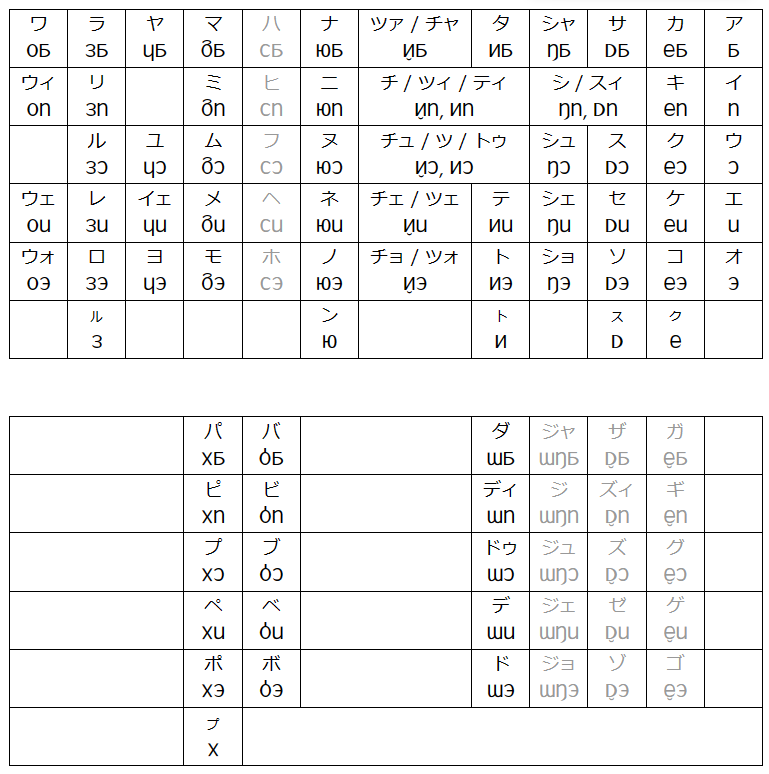
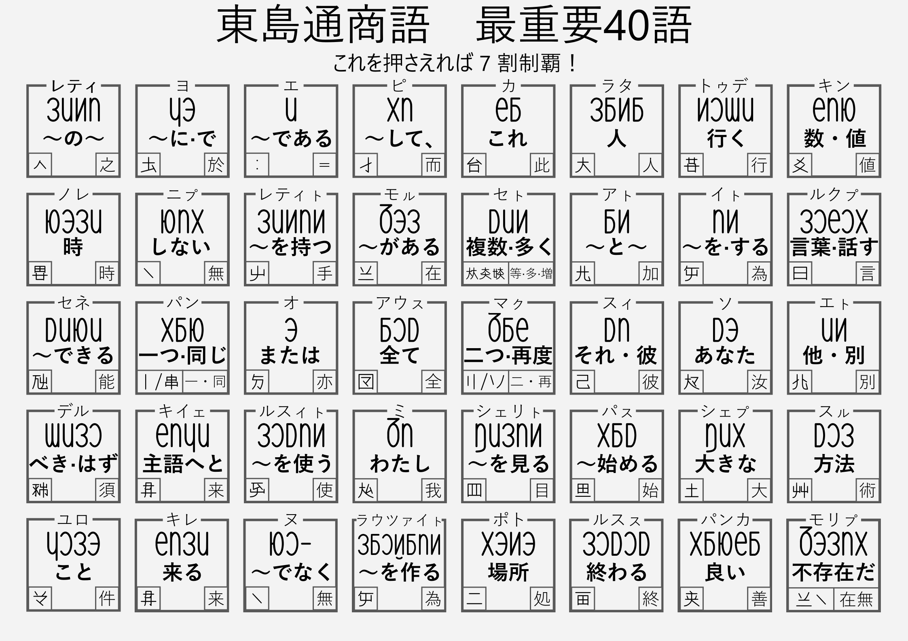
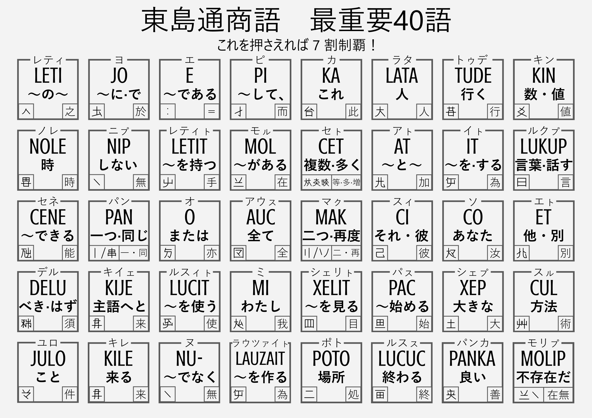

# pmcp_50on

pemecepe lujot・pemecepe lukup・takamamani を日本語話者に効率的に教えるための諸資料

## pemecepe lujot 50 音表（完成）

pemecepe lujot を日本語話者に効率的に教えるための 50 音表

## pemecepe lukup 最重要 40 語（完成）

東島通商語　最重要 40 語（これを押さえれば 7 割制覇！）

### ペメセペ・ルヨット版

#### 日本語版

### ラテン文字版

## takamamani 50 音表（完成）

takamamani を日本語話者に効率的に教えるための 50 音表

